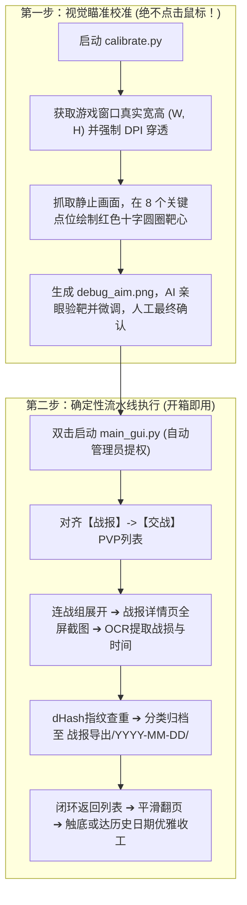

# 《三国志·战略版》官方PC端战报自动收集系统 (S3 Battle Report Collector)

[](https://www.python.org/)
[]()
[]()

专为《三国志·战略版》官方 PC 桌面客户端（`S3Client.exe`）定制的高清战报自动化采集、去重与智能归档系统。

---

## 📁 项目工程目录结构

```text
C:\sanguo_report_collector\
│
├── core\                         # 核心业务逻辑模块
│   ├── game_window.py            # 窗口探测、DPI校准、客户区坐标换算与MSS抓屏
│   ├── ocr_engine.py             # Windows原生高精度OCR引擎、动态卡片与文本定位
│   └── collector.py              # 全自动采集主引擎、连战状态机、dHash去重、三大护盾
│
├── docs\                         # 项目规格与技术资产库
│   ├── REQUIREMENTS.md           # 详细需求规格说明书（业务背景/用户画像/功能清单）
│   ├── PROMPTS.md                # 全套核心提示词资产库（系统规范/两步法/逆向分析）
│   └── TECHNICAL_DEEP_DIVE.md    # 深度技术剖析、踩坑指南与逆向实测证伪报告
│
├── templates\                    # 图像模板资源（金色返回键、胜负平标识、折叠箭头）
├── tools\                        # 辅助调试与诊断工具
│   └── live_inspector.py         # 真机多模态视觉实时透视与标注工具
│
├── calibrate.py                  # 【两步法第一步】视觉瞄准校准脚本（绝不点鼠标，纯画靶心）
├── main_gui.py                   # 桌面可视化 GUI 程序（支持一键提权、配置项）
├── config.json                   # 采集器运行时配置文件
├── requirements.txt              # Python 环境依赖清单
├── 战报收集.bat                   # 一键启动批处理脚本
└── 使用说明.txt                   # 面向普通用户的简易中文使用手册
```

---

## 🚀 核心工作流程与标准两步法

为彻底杜绝“盲猜坐标”和“点击死锁”，项目严格遵循**工业级标准化两步法**：



---

## 🛠️ 快速开始

### 1. 环境准备
确保已安装 Python 3.12+，在项目根目录下安装必要依赖：
```bash
pip install -r requirements.txt
```

### 2. 第一步：运行靶向校准（零风险瞄准）
将游戏保持在战报折叠列表界面，运行：
```bash
python calibrate.py
```
* 查看生成的 `debug_aim.png`，直观检查 8 个红圈十字靶心是否 100% 落在折叠条与返回按钮正中心。

### 3. 第二步：启动一键采集
双击桌面生成的快捷方式或运行：
```bash
python main_gui.py
```
点击 **【▶ 一键开始自动采集战报】** 即可。

---

## 📖 技术文档索引
* 📄 **[需求规格说明书](file:///C:/sanguo_report_collector/docs/REQUIREMENTS.md)**：详述核心业务目标、约束边界与功能矩阵。
* 📄 **[核心提示词资产库](file:///C:/sanguo_report_collector/docs/PROMPTS.md)**：沉淀全流程有效 Prompts，支持随时迁移与多大模型对话。
* 📄 **[技术剖析与踩坑指南](file:///C:/sanguo_report_collector/docs/TECHNICAL_DEEP_DIVE.md)**：详述 Ejoy2D 引擎逆向结论、本地缓存证伪分析、21像素偏差及连战死循环修复全过程。
